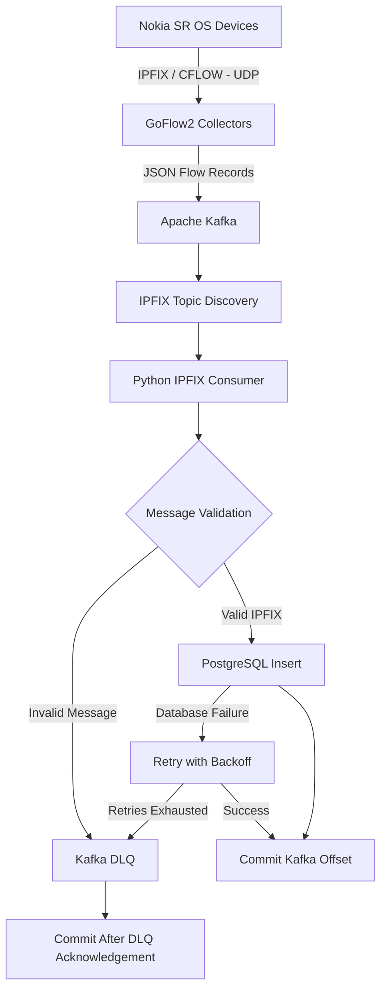

# NetOpsKube – IPFIX Flow Monitoring Pipeline

A Kubernetes-based, scalable and generic IPFIX flow collection and processing pipeline built using **GoFlow2, Apache Kafka, Python and PostgreSQL**.

The project collects IPFIX/CFLOW telemetry from Nokia SR OS network devices, transports flow records through Kafka, processes them using a Python consumer, and stores the complete flow data in PostgreSQL for further analysis and visualization.

The pipeline is designed to support multiple network clusters without requiring changes to the consumer application when new clusters or IPFIX topics are introduced.

---

## Table of Contents

- [Overview](#overview)
- [Architecture](#architecture)
- [Technology Stack](#technology-stack)
- [Repository Structure](#repository-structure)
- [How It Works](#how-it-works)
  - [1. IPFIX Collection – GoFlow2](#1-ipfix-collection--goflow2)
  - [2. Message Streaming – Apache Kafka](#2-message-streaming--apache-kafka)
  - [3. IPFIX Processing – Python Consumer](#3-ipfix-processing--python-consumer)
  - [4. Persistent Storage – PostgreSQL](#4-persistent-storage--postgresql)
  - [5. Dead Letter Queue – DLQ](#5-dead-letter-queue--dlq)
- [Key Design Principles](#key-design-principles)
- [Cluster Configuration](#cluster-configuration)
- [Consumer Configuration](#consumer-configuration)
- [Database Schema](#database-schema)
- [Error Handling and Reliability](#error-handling-and-reliability)
- [Deployment](#deployment)
- [Health Checks and Logs](#health-checks-and-logs)
- [Unit Test Coverage](#unit-test-coverage)

---

## Overview

The IPFIX monitoring pipeline provides an automated mechanism for collecting, processing and storing network flow telemetry.

IPFIX (Internet Protocol Flow Information Export) is a standard protocol used by network devices to export information about network traffic flows.

The pipeline uses the following processing sequence:

**Nokia SR OS → GoFlow2 → Apache Kafka → Python Consumer → PostgreSQL**

The main objectives are:

- Collect IPFIX/CFLOW telemetry from multiple network clusters.
- Convert incoming flow telemetry into JSON messages.
- Use Kafka as a distributed message streaming and buffering layer.
- Dynamically discover IPFIX Kafka topics.
- Process messages using a generic Python consumer.
- Preserve the complete IPFIX payload without hardcoding individual flow attributes.
- Store flow records in PostgreSQL using JSONB.
- Handle malformed messages and processing failures using a Dead Letter Queue.
- Prevent duplicate database records using Kafka message metadata.
- Deploy and manage the pipeline using Kubernetes manifests.

### Supported architecture

The current implementation uses a single Kafka broker, a Python consumer deployment with one replica, and PostgreSQL.

The design supports multiple IPFIX topics and Kafka partitions. Consumer replica scaling can be introduced separately when additional processing capacity is required.

---

## Architecture



### Component responsibilities

| Component | Responsibility |
|---|---|
| Nokia SR OS | Generates and exports IPFIX/CFLOW records |
| GoFlow2 | Receives flow exports and converts them into JSON |
| Apache Kafka | Buffers and distributes flow messages |
| Python Consumer | Discovers topics, validates and processes messages |
| PostgreSQL | Stores flow records and Kafka metadata |
| Kafka DLQ | Retains messages that cannot be processed |

---

## Technology Stack

| Technology | Purpose |
|---|---|
| Python 3.12 | Consumer application |
| kafka-python 2.2.15 | Kafka integration |
| psycopg2-binary 2.9.10 | PostgreSQL integration |
| GoFlow2 | IPFIX collection |
| Apache Kafka 4.1.0 | Message streaming |
| PostgreSQL 17 | Flow data storage |
| JSON / JSONB | Flexible flow payload representation |
| Docker | Containerization |
| Kubernetes | Deployment and orchestration |
| pytest | Unit testing |
| GitHub Actions | CI workflow |

---

## Repository Structure

```text
ipfix-consumer/
│
├── README.md
├── clusters.conf
│
├── consumer/
│   ├── Dockerfile
│   ├── consumer.py
│   ├── deployment.yaml
│   └── requirements.txt
│
├── goflow/
│   ├── namespace.yaml
│   └── templates/
│       ├── deployment.yaml.tmpl
│       └── service.yaml.tmpl
│
├── health-check/
│   ├── healthcheck.sh
│   └── logs.sh
│
├── kafka/
│   ├── service.yaml
│   ├── statefulset.yaml
│   ├── topic-ipfix-dlq.yaml
│   └── templates/
│       └── topic-job.yaml.tmpl
│
├── postgres/
│   ├── headless-service.yaml
│   ├── postgres-schema.yaml
│   ├── postgres-secret.yaml
│   ├── service.yaml
│   └── statefulset.yaml
│
├── scripts/
│   └── generate-ipfix-manifests.sh
│
└── tests/
    └── test_consumer_unit.py
```

---

## How It Works

### 1. IPFIX Collection – GoFlow2

GoFlow2 is responsible for receiving IPFIX flow exports from network devices.

The network devices export flow telemetry over UDP to the GoFlow2 collector.

GoFlow2 decodes the incoming flow information and converts it into JSON messages.

These messages are subsequently published to Kafka.

Each configured network cluster gets its own GoFlow2 deployment and corresponding Kafka topic.

For example:

| Network Cluster | GoFlow2 Deployment | Kafka Topic |
|---|---|---|
| bng-1 | goflow-bng-1 | ipfix-bng-1 |
| bng-2 | goflow-bng-2 | ipfix-bng-2 |
| dia-1 | goflow-dia-1 | ipfix-dia-1 |

This separation allows individual network clusters to have independent collection and message-streaming configurations.

### 2. Message Streaming – Apache Kafka

Apache Kafka acts as the intermediate message broker between GoFlow2 and the Python consumer.

Instead of directly inserting every flow record into PostgreSQL, GoFlow2 publishes the JSON messages to Kafka.

The consumer reads messages from Kafka and processes them independently.

This provides several advantages:

- Decouples flow collection from database processing.
- Buffers incoming flow records during temporary database outages.
- Supports partition-based parallel processing.
- Allows consumers to resume processing using committed offsets.
- Provides a common streaming platform for multiple network clusters.

#### Kafka topic naming convention

Each network cluster uses a dedicated topic.

```text
ipfix-<cluster_id>
```

Examples:

```text
ipfix-bng-1
ipfix-bng-2
ipfix-dia-1
```

A shared topic is used for failed messages:

```text
ipfix-dlq
```

#### Kafka partitions

Each IPFIX topic can contain multiple partitions.

For example:

```text
ipfix-bng-1
    ├── Partition 0
    ├── Partition 1
    └── Partition 2
```

Partitions allow Kafka to distribute messages and provide the foundation for parallel consumer processing.

The current configuration uses three partitions and a single Kafka broker.

### 3. IPFIX Processing – Python Consumer

The Python consumer is the central processing component of this repository.

It reads IPFIX messages from Kafka, validates the payload, identifies the originating cluster, and stores the complete message in PostgreSQL.

The consumer is designed to work with multiple network clusters without maintaining a hardcoded mapping of cluster names to Kafka topics.

#### Automatic topic discovery

The consumer subscribes using a regular expression:

```python
KAFKA_TOPIC_PATTERN = (
    rf"^(?!{re.escape(KAFKA_DLQ_TOPIC)}$)ipfix-.+$"
)
```

This allows the consumer to automatically discover topics following the `ipfix-` naming convention.

The shared DLQ topic is explicitly excluded to prevent the consumer from processing its own failed messages.

Kafka metadata is refreshed periodically using:

```text
KAFKA_METADATA_MAX_AGE_MS=30000
```

When a new matching Kafka topic is created, it can be discovered automatically during a subsequent metadata refresh.

No consumer code changes are required when a new network cluster is added.

#### Dynamic cluster identification

Each IPFIX topic represents one network cluster.

The consumer derives the cluster identifier directly from the Kafka topic name:

```python
cluster_id = message.topic.removeprefix("ipfix-")
```

For example:

| Kafka Topic | Derived Cluster ID |
|---|---|
| ipfix-bng-1 | bng-1 |
| ipfix-bng-2 | bng-2 |
| ipfix-dia-1 | dia-1 |

This eliminates the need for a hardcoded topic-to-cluster mapping inside the Python application.

#### Message validation

Before storing a message, the consumer validates the incoming Kafka payload.

The validation process checks:

1. The message is not null.
2. The payload can be decoded as UTF-8.
3. The payload contains valid JSON.
4. The JSON root element is an object.
5. The message type is `IPFIX`.

Only valid IPFIX messages are forwarded to PostgreSQL.

Invalid messages are published to the shared DLQ.

#### Generic payload processing

The consumer does not maintain a predefined list of Nokia SR OS flow attributes.

Instead, it stores the complete decoded JSON payload.

For example, a message containing:

```json
{
    "type": "IPFIX",
    "sampler_address": "10.3.4.1",
    "observation_domain_id": 100,
    "src_addr": "10.10.10.1",
    "dst_addr": "8.8.8.8"
}
```

is stored as a complete JSONB object.

If additional attributes are introduced in future IPFIX templates, they can be retained without requiring corresponding changes to the consumer's database insertion logic.

The consumer extracts only the metadata required for identification, indexing and ingestion management.

---

### 4. Persistent Storage – PostgreSQL

PostgreSQL is used as the persistent storage layer for processed IPFIX records.

The main table is:

```text
ipfix_flows
```

The table separates general ingestion metadata from the original IPFIX payload.

#### Database design

| Column | Data Type | Description |
|---|---|---|
| id | BIGSERIAL | Unique database record ID |
| cluster_id | TEXT | Originating network cluster |
| device | TEXT | Exporter/device identification, when available |
| source_topic | TEXT | Kafka topic |
| source_partition | INTEGER | Kafka partition |
| source_offset | BIGINT | Kafka message offset |
| time_received_ns | BIGINT | GoFlow2 receive timestamp |
| observation_domain_id | BIGINT | IPFIX observation domain |
| created_at | TIMESTAMPTZ | PostgreSQL insertion timestamp |
| raw_data | JSONB | Complete decoded IPFIX message |

#### Why JSONB?

IPFIX records can contain different attributes depending on the network device, exporter configuration and flow template.

Storing every possible attribute as an individual PostgreSQL column would make the database schema difficult to maintain.

Using JSONB provides flexibility.

For example, the following attributes can coexist in the same table:

```json
{
    "src_addr": "10.10.10.1",
    "dst_addr": "8.8.8.8",
    "proto": 6,
    "src_port": 443,
    "dst_port": 52000
}
```

Another record may contain additional attributes without requiring a database migration.

This design keeps the storage layer generic and allows future network clusters to introduce new flow attributes independently.

#### Indexing strategy

The database initialization job creates indexes for commonly accessed metadata:

- `cluster_id`
- `device`
- `source_topic`
- `created_at`
- `time_received_ns`
- `observation_domain_id`

A GIN index is also created on `raw_data` to support JSONB queries.

A unique index is created on:

```sql
(
    source_topic,
    source_partition,
    source_offset
)
```

This prevents the same Kafka message from being inserted more than once.

---

### 5. Dead Letter Queue – DLQ

The pipeline uses a shared Kafka Dead Letter Queue to preserve messages that cannot be processed successfully.

The configured topic is:

```text
ipfix-dlq
```

Messages are sent to the DLQ in the following situations:

- Invalid JSON payloads.
- Null Kafka messages.
- Unexpected message types.
- Invalid message structures.
- PostgreSQL insertion failures after all configured retries are exhausted.

#### DLQ message structure

A failed message is published with additional processing metadata.

Example:

```json
{
    "cluster_id": "bng-1",
    "source": {
        "topic": "ipfix-bng-1",
        "partition": 0,
        "offset": 100,
        "timestamp": 123456789
    },
    "failure": {
        "stage": "postgres_insert",
        "error_type": "OperationalError",
        "error_message": "Database connection failed",
        "retry_count": 5,
        "failed_at": "2026-11-12T10:00:00+00:00"
    },
    "original_message": {
        "type": "IPFIX"
    }
}
```

The original message is retained so that the failure can be investigated and the record can potentially be replayed later.

The DLQ is a separate failure-handling mechanism and is not part of the normal PostgreSQL ingestion path.

---

## Key Design Principles

### 1. Generic multi-cluster support

The consumer is not tied to a particular network cluster.

New clusters can be introduced by creating additional Kafka topics that follow the naming convention:

```text
ipfix-<cluster_id>
```

The consumer discovers the topics dynamically.

### 2. No hardcoded IPFIX payload fields

The consumer does not depend on a fixed set of Nokia SR OS flow attributes.

The original JSON payload is preserved in PostgreSQL JSONB.

Only the required ingestion metadata is extracted into dedicated database columns.

### 3. Separation of responsibilities

Each component has a clearly defined responsibility:

- GoFlow2 handles IPFIX collection.
- Kafka handles message streaming.
- Python handles validation and processing.
- PostgreSQL handles persistence.
- DLQ handles failed-message preservation.

### 4. Idempotent database insertion

Kafka messages are identified using:

```text
source_topic
source_partition
source_offset
```

The database uses a unique constraint and:

```sql
ON CONFLICT DO NOTHING
```

This prevents duplicate records when a previously processed message is delivered again.

### 5. Controlled Kafka offset management

Automatic Kafka offset commits are disabled.

```python
enable_auto_commit=False
```

Offsets are committed manually only after:

- Successful PostgreSQL insertion, or
- Successful DLQ publication acknowledged by Kafka.

This prevents the consumer from acknowledging messages before their processing outcome has been safely recorded.

---

## Cluster Configuration

Network cluster information is maintained in:

```text
clusters.conf
```

The configuration file uses a pipe-separated format:

```text
cluster_id|load_balancer_ip|kafka_partitions
```

Example:

```text
# cluster_id|load_balancer_ip|kafka_partitions

bng-1|172.18.0.104|3
```

Each configuration entry defines:

| Field | Description |
|---|---|
| cluster_id | Unique network cluster identifier |
| load_balancer_ip | GoFlow2 collector LoadBalancer IP |
| kafka_partitions | Number of Kafka partitions for the cluster topic |

To add another cluster, add a new entry.

For example:

```text
bng-1|172.18.0.104|3
bng-2|172.18.0.105|3
dia-1|172.18.0.106|3
```

The manifest generator validates the configuration before generating Kubernetes resources.

Validation includes:

- Cluster ID format and length.
- IPv4 address format and validity.
- Positive Kafka partition count.
- Duplicate cluster identifiers.
- Duplicate LoadBalancer addresses.
- Required configuration fields.

### Manifest generation

The repository provides:

```text
scripts/generate-ipfix-manifests.sh
```

Run:

```bash
bash scripts/generate-ipfix-manifests.sh
```

The script reads `clusters.conf` and generates the GoFlow2 and Kafka Kubernetes manifests.

For every configured cluster, it generates:

- A GoFlow2 Deployment.
- A GoFlow2 Service.
- A Kafka topic creation Job.

Generated naming conventions:

```text
GoFlow2 Deployment:
goflow-<cluster_id>

Kafka Topic:
ipfix-<cluster_id>

Kafka Topic Job:
kafka-create-topic-ipfix-<cluster_id>
```

The generator uses templates, allowing multiple clusters to share the same underlying Kubernetes resource definitions.

---

## Consumer Configuration

The consumer is configured using environment variables.

### Kafka configuration

| Variable | Default | Description |
|---|---|---|
| KAFKA_BROKER | kafka.nok-ipfix.svc.cluster.local:9092 | Kafka bootstrap server |
| KAFKA_GROUP_ID | ipfix-postgres-consumer | Consumer group |
| KAFKA_DLQ_TOPIC | ipfix-dlq | Shared DLQ topic |
| KAFKA_METADATA_MAX_AGE_MS | 30000 | Kafka metadata refresh interval |

### PostgreSQL configuration

| Variable | Default | Description |
|---|---|---|
| POSTGRES_HOST | ipfix-postgres.nok-ipfix.svc.cluster.local | PostgreSQL service |
| POSTGRES_PORT | 5432 | PostgreSQL port |
| POSTGRES_DB | ipfix | Database name |
| POSTGRES_USER | ipfix | Database user |
| POSTGRES_PASSWORD | ipfix-playground | Database password |

### Database retry configuration

| Variable | Default | Description |
|---|---|---|
| DB_MAX_RETRIES | 5 | Maximum database insertion attempts |
| DB_RETRY_BASE_SECONDS | 1 | Initial retry backoff interval |
| DB_RETRY_MAX_SECONDS | 30 | Maximum retry backoff interval |

These values can be overridden through Kubernetes environment variables.

**Security note:** The default database password is intended only for development. Use Kubernetes Secrets and replace default credentials before deploying in a production environment.

---

## Error Handling and Reliability

The consumer implements controlled error handling for PostgreSQL failures and invalid messages.

### Database retry mechanism

If PostgreSQL insertion fails, the consumer attempts the operation again.

The retry mechanism uses exponential backoff with full jitter.

The maximum delay is calculated using:

```python
maximum_delay = min(
    DB_RETRY_MAX_SECONDS,
    DB_RETRY_BASE_SECONDS * (2 ** (attempt - 1))
)
```

A random delay is selected between zero and the calculated maximum.

This helps prevent multiple consumers from repeatedly reconnecting to a recovering database at exactly the same time.

The database connection is rolled back and closed after a failed attempt. A new connection is established for the next attempt.

### Processing sequence

```text
Receive Kafka Message
        |
        v
Validate Message
        |
        +---- Invalid ----> Publish to DLQ
        |                       |
        |                       v
        |                 Confirm DLQ Delivery
        |                       |
        |                       v
        |                 Commit Kafka Offset
        |
        v
Insert into PostgreSQL
        |
        +---- Success ----> Commit Kafka Offset
        |
        |
        +---- Failure
                 |
                 v
          Retry PostgreSQL
                 |
                 +---- Success ----> Commit Kafka Offset
                 |
                 +---- Exhausted
                          |
                          v
                    Publish to DLQ
                          |
                          v
                    Confirm Delivery
                          |
                          v
                    Commit Kafka Offset
```

If DLQ publication fails, the consumer does not commit the original message offset.

The failure is propagated so that the original Kafka message remains available for replay.

### Delivery semantics

The consumer follows an at-least-once processing approach.

This means a message may be delivered again if the consumer fails between database insertion and Kafka offset commitment.

The PostgreSQL unique index on the Kafka source metadata ensures that such redelivery does not create duplicate database records.

The result is reliable, idempotent database ingestion under the current processing model.

---

## Deployment

The IPFIX pipeline is deployed and managed through **NetOpsKube**.

Unlike a standalone Kubernetes application, IPFIX is designed as an integrated component of the NetOpsKube environment. Its deployment is automated through the NetOpsKube Makefile, eliminating the need to manually apply individual Kubernetes manifests.

The deployment follows a two-stage approach:

1. **Deploy the base IPFIX infrastructure** – Deploy the shared components required for flow collection, streaming, processing and storage.
2. **Integrate network stacks** – Connect individual network stacks, such as BNG and DIA, to the shared IPFIX infrastructure.

This separation allows the IPFIX infrastructure to be deployed once and reused by multiple network stacks.

### Prerequisites

Before deploying IPFIX, ensure that:

- NetOpsKube has been cloned and configured.
- The NetOpsKube KinD Kubernetes cluster is up and running.
- The base NetOpsKube infrastructure has been deployed using `make try-nok`.
- The required IPFIX configuration and Kubernetes manifests are available under `nok-ipfix/`.
- The required container images are accessible to the KinD cluster.

Refer to the [NetOpsKube repository](https://github.com/CSPDevLabs/NetOpsKube) for environment setup and deployment instructions.

### Step 1: Deploy the base IPFIX infrastructure

Navigate to the NetOpsKube repository:

```bash
cd NetOpsKube
```

Configure the network clusters in:

```text
nok-ipfix/clusters.conf
```

The configuration defines the network clusters for which GoFlow2 collectors and Kafka topics will be generated.

Example:

```text
# cluster_id|load_balancer_ip|kafka_partitions

bng-1|172.18.0.104|3
```

Once the configuration is ready, execute:

```bash
make deploy-ipfix CLUSTER_ID=<cluster-id>
```

**That's it!** A single Make target deploys the complete base IPFIX pipeline.

The Makefile automatically handles the following operations:

| Stage | Operation |
|---|---|
| 1 | Generates cluster-specific GoFlow2 and Kafka manifests from `clusters.conf`. |
| 2 | Validates the generated manifests, required files, tools and Kubernetes connectivity. |
| 3 | Creates the IPFIX namespace and applies PostgreSQL credentials. |
| 4 | Deploys Apache Kafka and PostgreSQL. |
| 5 | Waits for Kafka and PostgreSQL StatefulSets to become ready. |
| 6 | Initializes the PostgreSQL database schema. |
| 7 | Creates and initializes the configured Kafka topics, including the shared DLQ topic. |
| 8 | Deploys the GoFlow2 collectors and their corresponding Kubernetes Services. |
| 9 | Deploys the Python IPFIX consumer. |
| 10 | Waits for the consumer deployment rollout and displays the IPFIX deployment status. |

The Makefile also performs prerequisite checks before starting the deployment and uses configurable rollout and job timeouts.

**Components deployed:**

- Apache Kafka
- PostgreSQL
- PostgreSQL schema initialization Job
- GoFlow2 collectors and Services
- Kafka topics for configured network clusters
- Shared Dead Letter Queue
- Python IPFIX consumer

The complete deployment is managed within the dedicated namespace:

```text
nok-ipfix
```

### Step 2: Verify the base IPFIX deployment

After deployment, check the status of the IPFIX components:

```bash
make status-ipfix
```

This target displays:

- Deployments and StatefulSets.
- Kubernetes Services and Jobs.
- Pod status and node placement.
- Persistent Volume Claims.

To inspect consumer logs:

```bash
kubectl logs -f deployment/ipfix-consumer -n nok-ipfix
```

Verify that Kafka, PostgreSQL, GoFlow2 and the consumer are running successfully before proceeding with network integration.

### Step 3: Integrate network stacks

Once the base IPFIX infrastructure is deployed, individual network stacks can be integrated with it.

For example, BNG and DIA can use the shared IPFIX infrastructure to export their flow telemetry.

The integration process connects the network stack's flow-export configuration to the corresponding GoFlow2 collector endpoint.

Conceptually:

```text
                NetOpsKube
                    |
                    v
          Base IPFIX Infrastructure
                    |
          +---------+---------+
          |                   |
          v                   v
       BNG Stack           DIA Stack
          |                   |
          v                   v
      GoFlow2 BNG         GoFlow2 DIA
          |                   |
          v                   v
     ipfix-bng-1          ipfix-dia-1
          |                   |
          +---------+---------+
                    |
                    v
              Apache Kafka
                    |
                    v
             Python Consumer
                    |
                    v
                PostgreSQL
```

Each network stack uses its corresponding GoFlow2 collector and Kafka topic. The shared Python consumer automatically discovers topics matching the `ipfix-` naming convention.

This means that adding another network stack does not require modifying the consumer application or introducing hardcoded cluster mappings.

Refer to the [NetOpsKube Makefile](https://github.com/CSPDevLabs/NetOpsKube/blob/deploy-ipfix/make/ipfix.mk) for the available IPFIX deployment and management targets.

### Deployment workflow summary

The overall deployment sequence is:

```bash
# 1. Deploy the NetOpsKube base environment
make try-nok

# 2. Deploy the shared IPFIX infrastructure
make deploy-ipfix CLUSTER_ID=<cluster-id>

# 3. Verify IPFIX deployment
make status-ipfix

# 4. Deploy and integrate the required network stacks
#    using their respective NetOpsKube deployment targets.
```

**Important:** The base IPFIX deployment should be completed before integrating network stacks that depend on its collectors and Kafka topics. There is no need to redeploy the shared Kafka, PostgreSQL or Python consumer infrastructure separately for every network stack.

## Health Checks and Logs

The IPFIX pipeline includes dedicated health-check and log-management scripts to simplify operational troubleshooting.

These scripts allow users to inspect the health of the deployed IPFIX components and retrieve logs without manually executing multiple Kubernetes commands.

The scripts are available under:

```text
health-check/
├── check-ipfix.sh
└── logs.sh
```

### 1. Health Check

The `check-ipfix.sh` script provides a centralized way to check the operational status of the IPFIX pipeline.

Run:

```bash
./health-check/check-ipfix.sh
```

The script is intended to help verify the deployed IPFIX components, identify unavailable resources and highlight deployment issues.

The health check covers the pipeline components:

- Python IPFIX consumer.
- GoFlow2 collectors.
- Apache Kafka.
- PostgreSQL.
- Kafka topics used by the IPFIX pipeline.

GoFlow2 deployments and IPFIX topics are not limited to a single network cluster. The health-check workflow should account for all configured instances rather than assuming a fixed number of collectors or topics.

A successful Kubernetes deployment confirms that resources have been deployed. Health checks provide an additional operational verification step.

### 2. Log Management

The `logs.sh` script provides a convenient interface for retrieving logs from individual IPFIX components or the complete pipeline.

Run the script using:

```bash
./health-check/logs.sh <component> [options]
```

#### Available components

| Component | Description |
|---|---|
| `all` | Display logs from all IPFIX components |
| `consumer` | Display Python consumer logs |
| `goflow2` | Display logs from all GoFlow2 collectors |
| `kafka` | Display Kafka broker logs |
| `postgres` | Display PostgreSQL logs |
| `topic` | Read messages directly from a Kafka topic |

#### View logs from all components

```bash
./health-check/logs.sh all
```

This retrieves logs from the consumer, all discovered GoFlow2 deployments, Kafka and PostgreSQL.

#### View logs from an individual component

Consumer:

```bash
./health-check/logs.sh consumer
```

GoFlow2:

```bash
./health-check/logs.sh goflow2
```

Kafka:

```bash
./health-check/logs.sh kafka
```

PostgreSQL:

```bash
./health-check/logs.sh postgres
```

#### Follow logs continuously

Use `--follow` to stream logs in real time.

For example:

```bash
# Follow all component logs concurrently
./health-check/logs.sh all --follow

# Follow consumer logs
./health-check/logs.sh consumer --follow

# Follow all GoFlow2 collector logs
./health-check/logs.sh goflow2 --follow

# Follow Kafka logs
./health-check/logs.sh kafka --follow
```

Press `Ctrl+C` to stop log streaming.

When following all components, the script streams logs concurrently and includes resource prefixes to help distinguish their output.

#### Control the number of log lines

By default, the script retrieves the latest 500 log lines.

Use `--tail` to change this limit:

```bash
# Retrieve the latest 100 log lines
./health-check/logs.sh all --tail 100

# Retrieve the latest 1000 consumer log lines
./health-check/logs.sh consumer --tail 1000
```

#### Retrieve logs from previous container instances

If a container restarts, its previous logs can be useful for troubleshooting.

Use:

```bash
./health-check/logs.sh consumer --previous
```

The `--previous` option retrieves logs from the previous container instance, where available.

### 3. Inspect Kafka Topic Messages

In addition to Kubernetes component logs, `logs.sh` provides an option to inspect messages directly from Kafka topics.

This is useful when troubleshooting the flow-processing pipeline.

Run:

```bash
./health-check/logs.sh topic
```

The script prompts for a Kafka topic name.

Alternatively, specify the topic directly:

```bash
./health-check/logs.sh topic ipfix-bng-1
```

Read messages from the beginning of a topic:

```bash
./health-check/logs.sh topic ipfix-bng-1 --from-beginning
```

Limit the number of messages:

```bash
./health-check/logs.sh topic ipfix-bng-1 --max-messages 100
```

This allows users to verify whether GoFlow2 is publishing flow records to Kafka independently of the Python consumer.

### 4. Script Options

The following options are supported by `logs.sh`:

| Option | Description |
|---|---|
| `--tail N` | Number of recent log lines (default: 500) |
| `--follow` | Continuously stream logs |
| `--previous` | Retrieve logs from the previous container instance |
| `--help` | Display usage information |

Display the available commands:

```bash
./health-check/logs.sh --help
```

### 5. Operational Troubleshooting Workflow

The health-check and log-management scripts can be used together to troubleshoot the pipeline.

A recommended troubleshooting sequence is:

**Step 1 – Check overall pipeline health**

```bash
./health-check/check-ipfix.sh
```

Identify any unavailable or unhealthy components.

**Step 2 – Inspect component logs**

```bash
./health-check/logs.sh all --tail 200
```

Review the logs for errors or unexpected behavior.

**Step 3 – Check GoFlow2 collection**

```bash
./health-check/logs.sh goflow2 --follow
```

Verify that the collectors are running and receiving flow exports.

**Step 4 – Verify Kafka messages**

```bash
./health-check/logs.sh topic ipfix-bng-1 --max-messages 20
```

Check whether flow records are being published to the expected Kafka topic.

**Step 5 – Inspect consumer processing**

```bash
./health-check/logs.sh consumer --follow
```

Check whether the consumer is discovering topics, processing messages and inserting records into PostgreSQL.

**Step 6 – Inspect database logs**

```bash
./health-check/logs.sh postgres --tail 200
```

Investigate database connection errors or insertion failures.

This workflow helps isolate issues across the collection, streaming, processing and storage layers.

### 6. Configuration

The scripts use configurable environment variables, with defaults suitable for the standard NetOpsKube IPFIX deployment.

The log-management script supports:

| Environment Variable | Default | Description |
|---|---|---|
| `IPFIX_NAMESPACE` | `nok-ipfix` | Kubernetes namespace |
| `KUBECTL` | `kubectl` | Kubernetes CLI executable |
| `IPFIX_CONSUMER_DEPLOYMENT` | `ipfix-consumer` | Consumer Deployment name |
| `IPFIX_KAFKA_STATEFULSET` | `kafka` | Kafka StatefulSet name |
| `IPFIX_KAFKA_BROKER` | `kafka.nok-ipfix.svc.cluster.local:9092` | Kafka broker address |
| `IPFIX_POSTGRES_STATEFULSET` | `ipfix-postgres` | PostgreSQL StatefulSet name |
| `IPFIX_GOFLOW_LABEL_SELECTOR` | `ipfix.cluster` | Label selector used to discover GoFlow2 deployments |

The scripts require `kubectl` access to the Kubernetes cluster and appropriate permissions to inspect the deployed resources.

---

**Note:** Health checks and log retrieval are operational utilities. They complement the deployment process and help troubleshoot individual components without requiring users to manually construct Kubernetes commands.


### Unit Test Coverage

The project includes unit tests for the Python IPFIX consumer, implemented using `pytest`.

The test suite uses mocked Kafka producers, consumers and PostgreSQL connections to validate the consumer's processing logic without requiring running Kafka or PostgreSQL instances.

The current test suite covers the following areas:

#### 1. Message Validation
- Successful processing of valid IPFIX messages.
- Handling of invalid JSON payloads.
- Handling of null Kafka messages.
- Rejection of unexpected message types.
- Handling of JSON arrays and strings instead of JSON objects.

#### 2. Dynamic Cluster and Device Identification
- Extracting cluster IDs from Kafka topic names.
- Supporting multiple network cluster topic names (BNG and DIA).
- Device identification using `sampler_address`.
- Fallback to `device` and `exporter_name` when `sampler_address` is unavailable.
- Handling messages without device identification.
- Processing multiple devices publishing to the same Kafka topic.

#### 3. Generic Payload Preservation
- Preserving unknown IPFIX attributes.
- Preserving nested JSON objects.
- Preserving JSON arrays.
- Handling missing optional fields.
- Verifying that the complete original JSON payload is retained.

#### 4. PostgreSQL Insertion
- Verifying database column mapping.
- Validating cluster and device metadata.
- Validating Kafka topic, partition and offset metadata.
- Validating flow timestamps and observation domain IDs.
- Verifying complete JSONB payload handling.
- Handling duplicate records using `ON CONFLICT DO NOTHING`.

#### 5. Database Retry Mechanism
- Recovering from temporary PostgreSQL failures.
- Creating a new database connection after a failed attempt.
- Rolling back and closing failed connections.
- Committing successful database transactions.
- Handling exhausted retry attempts.
- Verifying the configured maximum retry count.

#### 6. Dead Letter Queue (DLQ)
- Publishing invalid messages to the shared DLQ.
- Publishing messages after PostgreSQL retries are exhausted.
- Preserving the original message payload.
- Including source Kafka metadata and failure details.
- Verifying the destination DLQ topic.
- Handling Kafka DLQ publication failures.

#### 7. Kafka Offset Management
- Verifying offset commitment after successful message processing.
- Verifying offset commitment after successful DLQ handling.
- Verifying that duplicate messages are acknowledged.
- Ensuring the original Kafka message is not committed when DLQ publication fails.

### Running the Tests

From the repository root:

```bash
python -m pytest -v tests/test_consumer_unit.py
```

The tests use mocked external dependencies, so a running Kafka broker and PostgreSQL instance are not required.

### Continuous Integration

The repository includes GitHub Actions workflows under:

```text
.github/workflows/
```

The CI workflow is intended to validate the Python consumer through automated testing and build the Docker image.

This provides an automated validation step before publishing or deploying a new consumer image.


## Design Philosophy

The primary design goal is to keep the IPFIX ingestion pipeline generic, modular and extensible.

Adding a new network cluster should primarily involve configuration and Kubernetes resource generation rather than application code changes.

Similarly, introducing additional IPFIX fields should not require modifying the consumer or restructuring the database.

By combining GoFlow2, Kafka, Python and PostgreSQL, the project establishes a decoupled architecture for collecting and processing network flow telemetry across multiple network clusters.